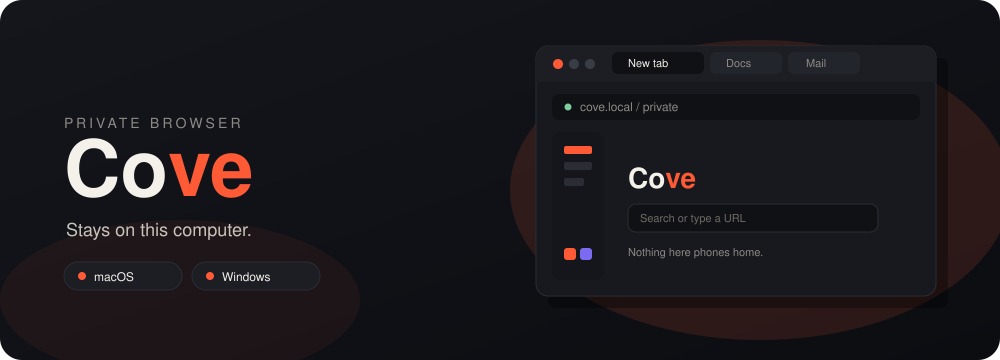

<div align="center">



<br/>


<br/>

[](https://github.com/AidanFitzpatrick-priv/Cove/tree/dev)
[](https://github.com/AidanFitzpatrick-priv/Cove/tree/dev)
[](#roadmap)
[](#roadmap)

<br/>

[](Cove.csproj)
[](https://dotnet.microsoft.com/download)
[](Cove.csproj)
[](#platforms)
[](#platforms)

<br/>

A small private browser. Cove uses the engine already on the computer, and keeps bookmarks, history, downloads, and passwords on that machine. No account. No sync.

<br/>

<a href="#features">Features</a> ·
<a href="#platforms">Platforms</a> ·
<a href="#run">Run</a> ·
<a href="#data">Data</a> ·
<a href="#roadmap">Roadmap</a>

</div>

---

## Features

The released app is [`master`](https://github.com/AidanFitzpatrick-priv/Cove/tree/master). It runs on macOS and Windows. [`dev`](https://github.com/AidanFitzpatrick-priv/Cove/tree/dev) is where changes land first.

<table>
<tr>
<td width="33%" valign="top">

### Tabs

Horizontal tabs, with the address bar underneath. Drag a tab to reorder it. Suggestions come from bookmarks and history as you type.

</td>
<td width="33%" valign="top">

### Sidebar

A slim sidebar docks on the left, right, or bottom, and collapses to icons.

</td>
<td width="33%" valign="top">

### Workspaces

Workspaces share logins. Each one has its own color.

</td>
</tr>
<tr>
<td width="33%" valign="top">

### Private windows

A private window skips history, suggestions, and saved passwords.

</td>
<td width="33%" valign="top">

### Appearance

Dark, light, or match the system, plus an accent color. Force dark asks web pages to follow. Session restore and blocking are settings too.

</td>
<td width="33%" valign="top">

### Blocking

Built-in ad and tracker blocking, with a one-click allow for the current site.

</td>
</tr>
<tr>
<td width="33%" valign="top">

### Password vault

Passwords stay on this computer, locked with a Cove password or this computer's sign-in. On a Mac, Touch ID works too.

</td>
<td width="33%" valign="top">

### Light on memory

A memory cap puts background tabs to sleep.

</td>
<td width="33%" valign="top">

### Video

Fullscreen video hides the sidebar and the top bar. Hover a video to pop it out.

</td>
</tr>
</table>

Unpacked extensions load from a folder that contains `manifest.json`. Cove runs their content scripts. Chrome extension APIs and background pages are not available.

Plugins are separate. Drop a folder or zip with a `cove-plugin.json` onto the Plugins panel and it loads immediately. A plugin can change Cove, except passwords. `examples/new-tab-background` and `examples/tab-sound` are the two samples.

<div align="center">


</div>

## Platforms

| | Engine | Status |
| --- | --- | --- |
| **macOS** 12.3 or later | System WebKit |  |
| **Windows** 10 or later | Edge WebView2 |  |
| **Linux** | — |  |
| **Mobile** | — |  |

On a Mac, a vault unlocked with sign-in or Touch ID keeps its key in the login keychain. On Windows, sign-in unlock uses DPAPI for the current user.

## Install

Windows setup is on the [latest release](https://github.com/AidanFitzpatrick-priv/Cove/releases/latest). An installed copy checks that page each time it opens and restarts into a newer release when one is there. A copy you build yourself does not check.

## Run

```text
cove@mac      ~/Cove   dev branch     WebKit
cove@windows  ~/Cove   dev branch     WebView2
```

**macOS and Windows**:

```bash
dotnet run --project Cove.csproj
```

<details>
<summary>dotnet is not on your PATH on a Mac</summary>

<br/>

```bash
export PATH="$HOME/.dotnet:$PATH"
export DOTNET_ROOT="$HOME/.dotnet"
dotnet run --project Cove.csproj
```

The first macOS build compiles `native/cove_webkit.m` into `libCoveWebKit.dylib`.

</details>

### Requirements

| | macOS | Windows |
| --- | --- | --- |
| System | macOS 12.3+ | Windows 10+ |
| SDK | [.NET 10](https://dotnet.microsoft.com/download) | [.NET 10](https://dotnet.microsoft.com/download) |
| Also | Xcode command line tools (`xcrun`, `clang`) | [WebView2 Runtime](https://developer.microsoft.com/microsoft-edge/webview2/) |

## Data

Nothing leaves the machine.

| | Folder |
| --- | --- |
| macOS | `~/Library/Application Support/Cove` |
| Windows | `%LOCALAPPDATA%\Cove` |

That folder holds the session, installed plugins, and the password vault. On Windows, the WebView2 profile lives there too.

## Roadmap

```text
[ ready   ] macOS      system WebKit
[ ready   ] Windows    Edge WebView2
[ planned ] Linux
[ planned ] Mobile
```

<div align="center">

**Private by default. Local by design.**

</div>
